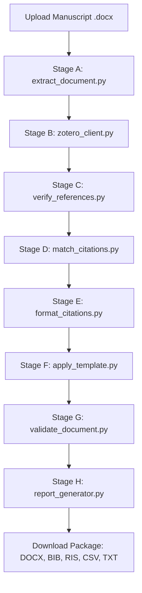

# 📚 Automated IEEE Research Paper Citation & Formatting System

> **A production-ready, privacy-first automation system that formats research manuscripts for IEEE journal submission — with interactive in-text hyperlinks, hover tooltips, multi-database reference verification, and strict word-for-word text preservation.**

[](https://ieee-citation-automation-system.onrender.com/)
[](https://github.com/yasirali7212/IEEE-Citation-Automation-System)
[](https://www.python.org/)
[](https://opensource.org/licenses/MIT)

🌐 **Live Application URL:** [https://ieee-citation-automation-system.onrender.com/](https://ieee-citation-automation-system.onrender.com/)

---


## 📑 Table of Contents

- [Overview](#overview)
- [Key Features](#key-features)
- [How It Works (Pipeline Stages)](#how-it-works-pipeline-stages)
- [Interactive Citations (Ctrl + Click & Tooltips)](#interactive-citations-ctrl--click--tooltips)
- [Journal Submission Package](#journal-submission-package)
- [Multi-User Security & Privacy Model](#multi-user-security--privacy-model)
- [Folder Structure](#folder-structure)
- [Quick Start Guide](#quick-start-guide)
  - [Prerequisites](#prerequisites)
  - [Option A: One-Click Windows Setup (Recommended)](#option-a-one-click-windows-setup-recommended)
  - [Option B: Manual Terminal Setup](#option-b-manual-terminal-setup)
- [Cloud Deployment (Render / Railway / Docker)](#cloud-deployment-render--railway--docker)
  - [Deploy to Render](#deploy-to-render)
  - [Deploy with Docker](#deploy-with-docker)
- [Output Deliverables & Audit Reports](#output-deliverables--audit-reports)
- [Configuration Reference (`.env`)](#configuration-reference-env)
- [Troubleshooting & FAQ](#troubleshooting--faq)

---

## 🌟 Overview

Preparing academic papers for IEEE journals often requires hours of tedious manual formatting: renumbering in-text citations into strict sequential order `[1]`, `[2]`, `[3]`, matching citations with reference list entries, hunting for missing DOIs, and formatting according to IEEE bibliographic standards.

This system fully automates that process in minutes while enforcing two non-negotiable academic principles:
1. **Strict 0-Change Text Preservation:** Your manuscript's prose, hypotheses, results, and discussions are untouched. Only citation brackets `[N]` are renumbered, and only the bibliography section is formatted.
2. **Interactive Jump Links & Tooltips:** In-text citations are converted into live Word bookmarks and hyperlinks (`Ctrl + Click` jumps directly to the cited paper) complete with hover ScreenTips showing authors, publication year, and paper title.

---

## ✨ Key Features

- **🔗 Interactive Document Navigation:** Every in-text citation marker (`[1]`, `[2]`, `[3]`) in Microsoft Word is a clickable bookmark hyperlink. Pressing `Ctrl + Click` immediately jumps the reader's view to the exact reference entry in the Bibliography.
- **💬 Hover ScreenTip Tooltips:** Hovering your mouse over any in-text citation displays a clean popup tooltip containing the reference's authors, year, and paper title.
- **🛡️ Strict Text Preservation Audit:** A dedicated validation engine compares every paragraph before and after processing. If even a single word outside citation markers is altered, the system flags it in an audit report.
- **🌐 Multi-Source Reference Verification:** Cross-verifies references against:
  - Personal **Zotero** libraries (via the Zotero Web API v3).
  - Public scholarly registries via the **Crossref REST API** (auto-discovering verified DOIs, volumes, issues, and page numbers).
  - Scholarly literature via the **Semantic Scholar API**.
- **📦 Multi-Format Reference Export:** Automatically generates `.bib` (BibTeX for LaTeX) and `.ris` (EndNote / Zotero / Mendeley exchange) files alongside your `.docx` paper.
- **🔒 Multi-User Privacy & Security:** Zero server storage for personal credentials. Each user can bring their own Zotero API key (or leave it blank to rely entirely on Crossref). Keys are processed purely in-memory and wiped immediately after conversion.
- **⚡ Modern Responsive Web Interface:** Includes real-time progress indicators, drag-and-drop file uploads, live status metrics, and a key validation tester.
- **🧹 Automatic Storage Maintenance:** Automatically cleans up uploads and processed files older than 24 hours to preserve server disk space and privacy.

---

## 🔄 How It Works (Pipeline Stages)

The processing pipeline executes across 8 coordinated stages:



1. **Stage A — Document Extraction ([`extract_document.py`](file:///d:/bot/scripts/extract_document.py)):**
   Inspects the Word document, identifies existing citation markers (`[1]`, `(Smith et al., 2020)`, etc.), locates the References heading, and extracts all raw bibliography items.
2. **Stage B — Zotero Sync ([`zotero_client.py`](file:///d:/bot/scripts/zotero_client.py)):**
   If the user supplies a personal Zotero API key, it fetches the user's library items and builds an in-memory lookup index. If no key is provided, it gracefully skips to online registry search.
3. **Stage C — Registry Verification ([`verify_references.py`](file:///d:/bot/scripts/verify_references.py)):**
   Queries Crossref and Semantic Scholar to match titles and authors, retrieving verified DOIs, official journal names, publication dates, and volume/page numbers.
4. **Stage D — Citation Mapping ([`match_citations.py`](file:///d:/bot/scripts/match_citations.py)):**
   Scans the document in chronological reading order and assigns new sequential IEEE numbers `[1]`, `[2]`, `[3]` based on each reference's first appearance in the manuscript text.
5. **Stage E — IEEE Formatting & Interactive Linking ([`format_citations.py`](file:///d:/bot/scripts/format_citations.py)):**
   Updates citation markers in the body text. Embeds Word `<w:hyperlink>` elements pointing to `<w:bookmarkStart>` anchors in the Bibliography, configures hover ScreenTips, and formats the references in official IEEE style.
6. **Stage F — Template Formatting ([`apply_template.py`](file:///d:/bot/scripts/apply_template.py)):**
   If an optional IEEE journal template (`.docx`) is uploaded, applies two-column layout, margins, headers/footers, and standard typography without altering manuscript content.
7. **Stage G — Text Preservation Audit ([`validate_document.py`](file:///d:/bot/scripts/validate_document.py)):**
   Diffs every single paragraph between the original and output files to mathematically prove that 0 manuscript words were modified.
8. **Stage H — Export & Report Generation ([`report_generator.py`](file:///d:/bot/scripts/report_generator.py)):**
   Builds the final submission bundle including the formatted paper, verification spreadsheet, preservation report, `references.bib`, and `references.ris`.

---

## 🎯 Interactive Citations (Ctrl + Click & Tooltips)

In Microsoft Word, standard bracketed citations like `[1]` are plain text. This workflow upgrades every citation into an **active internal Word bookmark**:

| Feature | How It Works in Microsoft Word |
| :--- | :--- |
| **`Ctrl + Click` Jump** | Holding `Ctrl` and clicking any citation `[N]` instantly moves your cursor and viewport directly to that reference entry in the **References** section. |
| **Hover ScreenTip** | Hovering your mouse cursor over `[N]` displays a tooltip showing the reference details: e.g., `M. McCartney (1976) Optics of the Atmosphere: Scattering by Molecules and Particles`. |
| **Clickable DOIs** | Every reference entry in the bibliography features an active hyperlink to `https://doi.org/...` for instant one-click browser verification by reviewers and editors. |

---

## 📤 Journal Submission Package

When submitting your paper to an IEEE journal or conference (via IEEE Author Portal, ScholarOne, or EDAS), here is what each generated file is for:

| File Name | Purpose | What to Do With It |
| :--- | :--- | :--- |
| **`IEEE_Formatted_Research_Paper.docx`** | **Primary Manuscript** | **Upload as your main manuscript file** to the journal submission portal. |
| **`Original_Research_Paper_Backup.docx`** | Safety Backup | Keep for your records. Proves original state before processing. |
| **`references.bib`** | BibTeX Export | Upload under "Supplementary Files" if the journal requests a `.bib` file. |
| **`references.ris`** | EndNote / Zotero Export | Upload under "Supplementary Files" or import directly into your reference manager. |
| **`Citation_Verification_Report.csv`** | Verification Audit | Spreadsheet listing all references, verification status, and DOI links. |
| **`Text_Preservation_Report.txt`** | Text Integrity Proof | Detailed diff confirming zero altered manuscript words. |
| **`Unresolved_Citations_Report.txt`** | Quality Check | Highlights any reference that could not be matched with 100% confidence. |

---

## 🔐 Multi-User Security & Privacy Model

This system is engineered for multi-user shared deployment (e.g. hosted on Render, Railway, or an internal research lab server) with **strict zero-trust privacy**:

- **No Central Keys:** The server holds **no global Zotero API keys** or personal passwords.
- **In-Memory Credential Scope:** When a user inputs their personal Zotero API key in the web interface, it is passed strictly to the child subprocess of that specific conversion task. It is never written to disk, `.env`, or server logs, and is discarded from memory when the task finishes.
- **Browser-Only Storage:** Users can check *"Remember key in my browser only"*. This stores the key strictly inside the visitor's local browser (`localStorage`) on their personal computer. Other users or server administrators cannot view it.
- **Zero-Setup Mode:** If a user does not have a Zotero account, they simply leave the Zotero field blank. The system automatically performs reference matching using public Crossref and Semantic Scholar APIs.

---

## 📁 Folder Structure

```
d:\bot\
├── README.md                          # Full system documentation (this file)
├── setup.bat                          # One-click Windows setup script
├── start_server.bat                   # One-click local web server launcher
├── requirements.txt                   # Python package dependencies
├── .env.example                       # Environment configuration template
├── .env                               # Local configuration (never committed to git)
├── .gitignore                         # Git exclusion rules
├── .dockerignore                      # Docker build exclusion rules
├── Dockerfile                         # Production container image definition
├── Procfile                           # Process file for cloud deployment (gunicorn)
├── render.yaml                        # Infrastructure-as-code blueprint for Render
├── n8n_workflow.json                  # Optional n8n workflow definition
│
├── scripts/                           # Core processing pipeline engines
│   ├── extract_document.py            # Stage A: Extract text & raw references
│   ├── zotero_client.py               # Stage B: Zotero Web API v3 integration
│   ├── verify_references.py           # Stage C: Crossref & Semantic Scholar lookup
│   ├── match_citations.py             # Stage D: Chronological citation renumbering
│   ├── format_citations.py            # Stage E: Hyperlinks, tooltips & IEEE styling
│   ├── apply_template.py              # Stage F: Layout & template style application
│   ├── validate_document.py           # Stage G: Mathematical text preservation audit
│   ├── crossref_client.py             # Crossref REST API client
│   └── report_generator.py            # Stage H: BibTeX, RIS & audit report generator
│
├── server/                            # Web application
│   └── app.py                         # Flask web application & responsive UI
│
├── uploads/                           # Temporary folder for uploaded files (auto-cleaned)
├── outputs/                           # Generated manuscripts & reports (auto-cleaned)
└── logs/                              # Execution logs for each conversion stage
```

---

## 🚀 Quick Start Guide

### Prerequisites
- Windows 10/11, macOS, or Linux.
- **Python 3.10 or newer** ([Download from python.org](https://www.python.org/downloads/)). Make sure to check **"Add Python to PATH"** during installation.

---

### Option A: One-Click Windows Setup (Recommended)

1. **Run Setup:**
   Double-click [`setup.bat`](file:///d:/bot/setup.bat). This will automatically create all necessary folders and install Python dependencies.
2. **Start the Server:**
   Double-click [`start_server.bat`](file:///d:/bot/start_server.bat).
3. **Use the Application:**
   Your browser will automatically open to `http://localhost:8080`.
   - Drag & drop your manuscript (`.docx`).
   - (Optional) Drag & drop an IEEE conference/journal template (`.docx`).
   - (Optional) Enter your personal Zotero API key or click **Test Connection**.
   - Click **🚀 Run Workflow**.
   - Download your formatted paper, `.bib`, `.ris`, and audit reports!

---

### Option B: Manual Terminal Setup

1. **Clone or navigate to the project directory:**
   ```bash
   cd d:\bot
   ```

2. **Create a virtual environment (optional but recommended):**
   ```bash
   python -m venv venv
   # On Windows:
   venv\Scripts\activate
   # On Linux/macOS:
   source venv/bin/activate
   ```

3. **Install dependencies:**
   ```bash
   pip install -r requirements.txt
   ```

4. **Copy the environment configuration:**
   ```bash
   copy .env.example .env
   ```

5. **Start the web application:**
   ```bash
   python server\app.py
   ```
   Open `http://localhost:8080` in your browser.

---

## ☁️ Cloud Deployment (Render / Railway / Docker)

You can host this application online so your entire research team or lab can format papers from anywhere.

### Live Deployment on Render

The system is deployed and publicly accessible on Render's free tier:  
👉 **[https://ieee-citation-automation-system.onrender.com/](https://ieee-citation-automation-system.onrender.com/)**

### Deploy Your Own Instance to Render

1. Fork or push this repository to your GitHub account:
   ```bash
   git remote add origin https://github.com/yasirali7212/IEEE-Citation-Automation-System.git
   git branch -M main
   git push -u origin main
   ```
2. Log in to [Render.com](https://render.com) and click **New + -> Web Service**.
3. Connect your repository (`yasirali7212/IEEE-Citation-Automation-System`).
4. Render will automatically detect [`render.yaml`](file:///d:/bot/render.yaml):
   - **Environment:** Python
   - **Build Command:** `pip install -r requirements.txt`
   - **Start Command:** `gunicorn --bind 0.0.0.0:$PORT server.app:app --timeout 600 --workers 2`
   - **Plan:** Free ($0/month)
5. Click **Create Web Service**. Your service will be live on a free public HTTPS URL in under 2 minutes!


### Deploy with Docker

A production [`Dockerfile`](file:///d:/bot/Dockerfile) is included:

```bash
# Build the Docker container
docker build -t ieee-citation-workflow .

# Run the container on port 8080
docker run -d -p 8080:8080 --name citation-app ieee-citation-workflow
```
Access the application at `http://localhost:8080`.

---

## 📊 Output Deliverables & Audit Reports

Every conversion job creates an isolated folder inside `outputs/<job_id>/` containing:

| Output Deliverable | Format | Description |
| :--- | :---: | :--- |
| **`IEEE_Formatted_Research_Paper.docx`** | DOCX | Ready-to-submit paper with clickable citations, hover tooltips, and IEEE references. |
| **`Original_Research_Paper_Backup.docx`** | DOCX | Pristine copy of the uploaded file before any processing occurred. |
| **`references.bib`** | BIB | Standard BibTeX formatted file containing all verified references. |
| **`references.ris`** | RIS | Research Information Systems file for importing into EndNote or Mendeley. |
| **`Citation_Verification_Report.csv`** | CSV | Comprehensive table with columns: `Ref #`, `Citation Key`, `Verification Source`, `DOI`, `Match Score`, and `Title`. |
| **`Text_Preservation_Report.txt`** | TXT | Full mathematical verification proof comparing body text word-for-word. |
| **`Unresolved_Citations_Report.txt`** | TXT | Summary of any citations requiring author attention before submission. |

---

## ⚙️ Configuration Reference (`.env`)

Settings can be customized in the [`.env`](file:///d:/bot/.env) file:

```ini
# ── Optional Zotero Defaults (can be left blank for multi-user setups) ──
ZOTERO_API_KEY=
ZOTERO_USER_ID=
ZOTERO_LIBRARY_TYPE=user

# ── Crossref API Identification (Free, polite pool for faster lookups) ──
CROSSREF_EMAIL=citation-workflow@example.com

# ── Server & File Storage Settings ──
PORT=8080
UPLOAD_FOLDER=uploads
OUTPUT_FOLDER=outputs
LOG_FOLDER=logs
MAX_FILE_SIZE_MB=50

# ── Optional n8n Webhook (if orchestrating via n8n) ──
N8N_WEBHOOK_URL=http://localhost:5678/webhook/ieee-citation-workflow
```

---

## ❓ Troubleshooting & FAQ

### Q: Does this system rewrite or summarize my paper?
**No, absolutely not.** The software utilizes deterministic python-docx manipulation, not generative AI rewriting. Every word, sentence, table, and figure in your paper remains 100% unaltered.

### Q: Why do `Ctrl + Click` hyperlinks not jump in Word?
Ensure you are holding the **`Ctrl`** key while clicking the citation bracket (this is Microsoft Word's default behavior for following internal hyperlinks). In Word Options -> Advanced, ensure *"Use CTRL + Click to follow hyperlink"* is enabled.

### Q: Do I need a Zotero account to use this system?
**No.** Zotero is completely optional. If you do not provide a Zotero key, the system automatically uses Crossref and Semantic Scholar to match and format your references.

### Q: How do I get a free Zotero API key?
1. Log into your account at [zotero.org/settings/keys](https://www.zotero.org/settings/keys).
2. Click **Create new private key**.
3. Name it `ieee-workflow` and check **Allow library access** (Read Only).
4. Copy the generated key and paste it into the web UI.

### Q: Can I run this without an internet connection?
Local parsing, text extraction, document formatting, hyperlink injection, and text preservation validation all run 100% locally on your computer. An internet connection is only needed during Stage C if verifying references against Crossref or Zotero's cloud API.

---

## 📄 License & Attribution

Developed for researchers, academics, and graduate students worldwide.  
Distributed under the **MIT License**. Free for academic, personal, and commercial research use.
